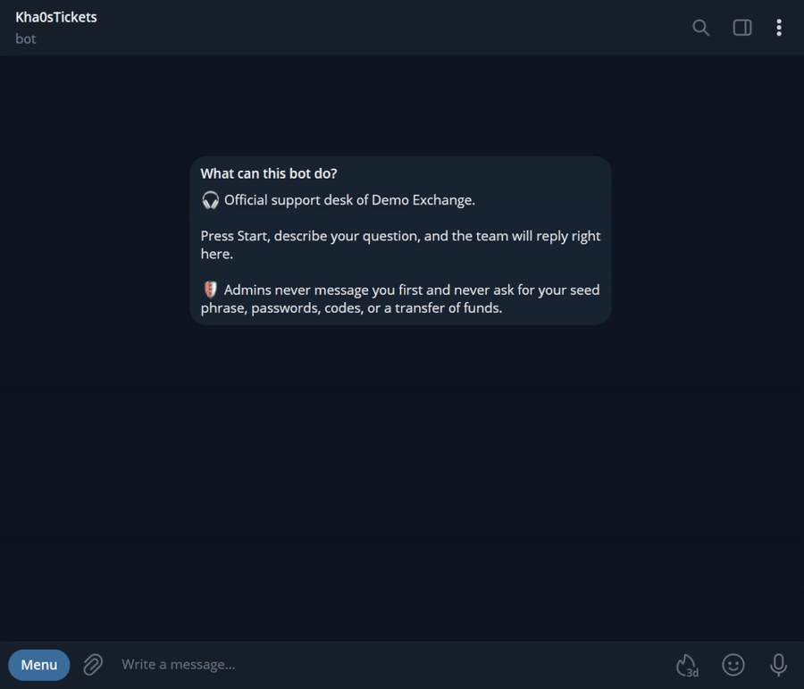

# Telegram Ticket Bot

[](https://nodejs.org/)
[](https://www.typescriptlang.org/)
[](https://grammy.dev/)
[](LICENSE)

A support desk in a box for Telegram communities and businesses. Users open a private ticket with one button, and every ticket becomes its own topic in your staff group — conversations stay organized, and closing a ticket produces a downloadable transcript.

## Demo



## How it works

1. A user opens the bot and sees a branded welcome with an anti-scam notice. They pick a topic (Deposit, Withdrawal, Bug report, Other) — or just start writing, and the bot asks for the topic once. Nothing they wrote is lost.
2. The bot creates a forum topic in your support group, named `#id · category · @username`, and posts a staff card with the user's name, id, language, topic, and a **Close ticket** button.
3. Everything the user writes is relayed into the topic and marked with a 👀 reaction as a delivery receipt; staff replies in the topic are relayed back. Media messages are relayed too.
4. Either side can close the ticket: staff with the button or `/close [reason]`, the user with their own button or `/close`. A `.txt` transcript is posted in the topic, the topic is closed, and the user is asked to rate the support from 1 to 5 stars. The rating is posted in the topic.

The bot speaks Russian to Russian-speaking users (ru, uk, be, kk) and English to everyone else.

## Commands

| Command | Where | Who | Purpose |
| --- | --- | --- | --- |
| `/start` | Direct messages | Users | Show the welcome panel with topic buttons |
| `/close` | Direct messages | Users | Close their own ticket |
| `/close [reason]` | Ticket topic | Staff | Close the ticket, notify the user, post a transcript |
| `/tickets` | Support group | Staff | List open tickets with category and age |
| `/purge` | Support group | Group owner | Delete all tickets and their topics after confirmation; numbering restarts at #1. Requires the bot's *Delete messages* right. Not shown in the command menu |

## Customization per client

| Variable | Default | Purpose |
| --- | --- | --- |
| `BRAND_NAME` | `Support` | Project name in the welcome message and bot profile |
| `CATEGORIES` | Deposit, Withdrawal, Bug report, Other | Ticket topics: `EN \| RU` pairs separated by `;`, up to 8 |
| `STAFF_LANG` | `en` | Language of messages in the support group (`en` or `ru`) |
| `SCAM_NOTICE` | Crypto anti-scam line | Safety line under the welcome: `off` to hide it, or your own `EN \| RU` text (for example, about card details for a shop) |

The defaults target crypto projects. For other niches, set your own `CATEGORIES` and `SCAM_NOTICE`.

After setting `BRAND_NAME` or `SCAM_NOTICE`, run `npm run setup-profile` once: it sets the bot's description, short description, and command menus in English and Russian.

## Guarantees

- One active ticket per user — pressing the button twice is rejected.
- Only group administrators and the owner count as staff; regular members cannot close tickets or reply through the bot.
- Transcript entries record direction, sender, timestamp, and text for every relayed message.
- Webhook deployments reject requests without the correct Telegram secret token header.

## Requirements

- A bot token from [@BotFather](https://t.me/BotFather).
- A **supergroup with Topics enabled** as the support group. Convert a group to a supergroup in group settings, then enable Topics.
- The bot added to the group and promoted to **administrator** with *Manage Topics* permission.
- The group's numeric id (a negative number). A quick way to get it: add [@RawDataBot](https://t.me/RawDataBot) to the group, read the `chat.id` field, then remove it.

## Local setup

```powershell
Copy-Item .env.example .env
npm install
npm run dev
```

Set in `.env`:

```env
BOT_TOKEN=123456789:replace_with_your_bot_token
STAFF_GROUP_ID=-1001234567890
```

The store persists to `data/store.json` (override with `STORE_PATH`). Local mode removes an active webhook before polling begins, so local and Vercel modes should be used separately.

## Deploy to Vercel

1. Import this repository into Vercel (CLI: `vercel`), or push and import from GitHub.
2. Create a free Redis database at [Upstash](https://upstash.com) and copy its REST URL and token.
3. Set environment variables: `BOT_TOKEN`, `STAFF_GROUP_ID`, `WEBHOOK_SECRET` (random string of letters, digits, `_`, `-`), `UPSTASH_REDIS_REST_URL`, and `UPSTASH_REDIS_REST_TOKEN`. Optionally set `STORE_KEY` to host several bots in one database.
4. Deploy and note the production domain, such as `https://telegram-ticket-bot.vercel.app`.
5. Set `WEBHOOK_URL` in local `.env` and run:

```powershell
npm run set-webhook
```

Telegram will deliver updates to `https://your-project.vercel.app/api/bot`. The endpoint verifies Telegram's `X-Telegram-Bot-Api-Secret-Token` header against `WEBHOOK_SECRET`.

> **Storage note:** Vercel's filesystem is ephemeral, so the bot stores tickets in Upstash Redis there. Each update reloads the latest state, so separate serverless instances stay in sync. Without Upstash variables the bot falls back to a local JSON file (`STORE_PATH`), which suits long polling on a VPS.

## Quality checks

```powershell
npm test
npm run build
```

`npm test` covers ticket lifecycle rules, one-ticket-per-user enforcement, pending messages, ratings, categories config, translations, button callback parsing, transcript formatting, staff permission checks, and storage backends (file, Upstash via a mocked fetch, reload across instances). `npm run build` validates TypeScript without emitting artifacts.

## Project structure

```text
api/bot.ts              Vercel webhook entry point
scripts/set-webhook.ts  Registers the Telegram webhook
scripts/setup-profile.ts  Sets bot description and command menus (en + ru)
src/bot.ts              grammY handlers: panel, categories, relaying, close, rating, listing
src/callbacks.ts        Inline button callback data encoding and parsing
src/categories.ts       Ticket categories and their config parsing
src/i18n.ts             Russian and English texts, language detection
src/config.ts           Environment configuration and validation
src/permissions.ts      Staff status checks
src/tickets.ts          Ticket store: lifecycle, one-per-user rule, persistence
src/storage.ts          Storage backends: JSON file, Upstash Redis, in-memory
src/transcript.ts       Topic titles and closing transcripts
src/webhook.ts          Webhook secret validation
src/logger.ts           Structured JSON logger
src/index.ts            Local long-polling entry point
test/                   Unit tests for pure logic
```

## License

Distributed under the [MIT License](LICENSE).
